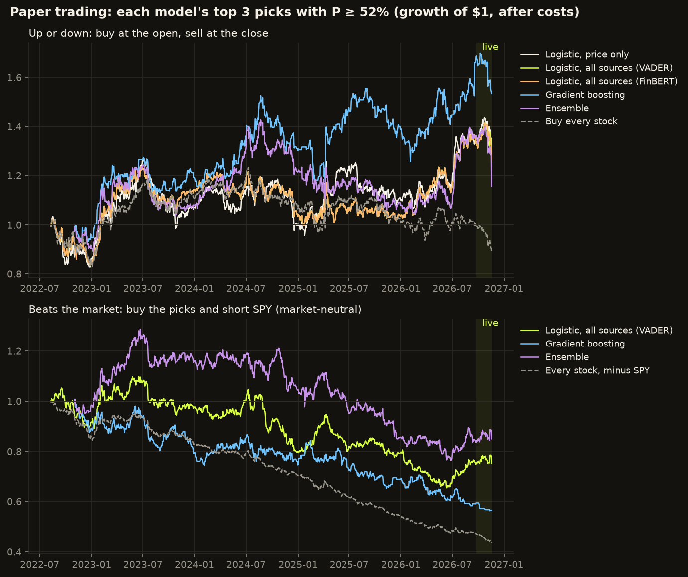

# Stock prediction lab: latest report

Generated 2026-11-17 04:29 UTC.

## Next-session calls

| Rank | Stock | P(up) | Call | P(beats SPY) | vs the market | Headlines (24 h) | Mood: VADER | Mood: FinBERT |
|---|---|---|---|---|---|---|---|---|
| 1 | META | **55.0%** | **Buy at open** | 61.7% | **Outperform** | 19 | neutral (-0.00) | negative (-0.21) |
| 2 | MSFT | **51.3%** | Stay out | 48.2% | – | 14 | negative (-0.09) | negative (-0.39) |
| 3 | XOM | **50.7%** | Stay out | 57.0% | **Outperform** | 17 | positive (+0.14) | neutral (+0.03) |
| 4 | JPM | **50.4%** | Stay out | 53.0% | – | 9 | neutral (-0.00) | negative (-0.41) |
| 5 | AAPL | **48.8%** | Stay out | 54.4% | **Outperform** | 18 | neutral (-0.01) | neutral (+0.03) |
| 6 | AMZN | **48.6%** | Stay out | 47.2% | – | 18 | negative (-0.07) | negative (-0.31) |
| 7 | TSLA | **46.8%** | Stay out | 51.0% | – | 18 | neutral (-0.02) | negative (-0.16) |
| 8 | NVDA | **44.5%** | Stay out | 27.1% | – | 16 | neutral (+0.02) | neutral (-0.00) |
| 9 | UNH | **44.1%** | Stay out | 41.8% | – | 1 | positive (+0.49) | neutral (+0.03) |
| 10 | GOOGL | **41.9%** | Stay out | 41.7% | – | 17 | positive (+0.11) | negative (-0.27) |

Every model's probability:

| Stock | P(up): logistic, price only | P(up): logistic, all sources (VADER) | P(up): logistic, all sources (FinBERT) | P(beats SPY): logistic, all sources (VADER) | P(up): gradient boosting | P(beats SPY): gradient boosting | P(up): ensemble | P(beats SPY): ensemble |
|---|---|---|---|---|---|---|---|---|
| AAPL | 50.9% | 53.3% | 45.4% | 54.4% | 44.3% | 51.4% | 48.8% | 52.9% |
| AMZN | 49.0% | 49.4% | 48.0% | 47.2% | 47.8% | 51.0% | 48.6% | 49.1% |
| GOOGL | 39.6% | 29.3% | 24.3% | 41.7% | 54.5% | 51.7% | 41.9% | 46.7% |
| JPM | 61.1% | 51.8% | 47.3% | 53.0% | 48.9% | 51.4% | 50.4% | 52.2% |
| META | 60.5% | 55.6% | 54.8% | 61.7% | 54.5% | 50.7% | 55.0% | 56.2% |
| MSFT | 53.0% | 52.8% | 59.2% | 48.2% | 49.7% | 51.4% | 51.3% | 49.8% |
| NVDA | 41.2% | 31.3% | 33.5% | 27.1% | 57.7% | 50.4% | 44.5% | 38.7% |
| TSLA | 50.7% | 49.2% | 49.7% | 51.0% | 44.5% | 50.3% | 46.8% | 50.7% |
| UNH | 46.3% | 46.0% | 41.0% | 41.8% | 42.3% | 46.8% | 44.1% | 44.3% |
| XOM | 53.7% | 54.1% | 55.1% | 57.0% | 47.3% | 51.4% | 50.7% | 54.2% |

## Accuracy: up or down?

| | Predictions | Accuracy | 95% range | Always up | Same as today | Beats baselines? | Brier |
|---|---|---|---|---|---|---|---|
| Live, logistic, price only | 370 | **51.6%** | 46.5%–56.7% | 46.5% | 48.4% | no | 0.2497 |
| Live, logistic, all sources (VADER) | 370 | **53.0%** | 47.9%–58.1% | 46.5% | 48.4% | no | 0.2517 |
| Live, logistic, all sources (FinBERT) | 370 | **53.5%** | 48.4%–58.6% | 46.5% | 48.4% | no | 0.2512 |
| Live, gradient boosting | 370 | **51.9%** | 46.8%–57.0% | 46.5% | 48.4% | no | 0.2475 |
| Live, ensemble | 370 | **53.8%** | 48.7%–58.9% | 46.5% | 48.4% | within noise | 0.2474 |
| Historical replay, logistic, price only | 10,348 | **51.0%** | 50.0%–51.9% | 52.2% | 49.8% | no | 0.2523 |
| Historical replay, logistic, all sources (VADER) | 10,348 | **50.4%** | 49.4%–51.4% | 52.2% | 49.8% | no | 0.2544 |
| Historical replay, logistic, all sources (FinBERT) | 10,348 | **50.4%** | 49.4%–51.4% | 52.2% | 49.8% | no | 0.2544 |
| Historical replay, gradient boosting | 9,758 | **50.1%** | 49.1%–51.1% | 52.4% | 49.8% | no | 0.2592 |
| Historical replay, ensemble | 9,758 | **51.5%** | 50.5%–52.5% | 52.4% | 49.8% | no | 0.2533 |

## Accuracy: beats the market?

| | Predictions | Accuracy | 95% range | Always beats | Same as today | Beats baselines? | Brier |
|---|---|---|---|---|---|---|---|
| Live, logistic, all sources (VADER) | 370 | **54.1%** | 49.0%–59.1% | 47.0% | 47.0% | within noise | 0.2537 |
| Live, gradient boosting | 370 | **53.5%** | 48.4%–58.6% | 47.0% | 47.0% | within noise | 0.2493 |
| Live, ensemble | 370 | **53.8%** | 48.7%–58.9% | 47.0% | 47.0% | within noise | 0.2498 |
| Historical replay, logistic, all sources (VADER) | 10,348 | **51.4%** | 50.4%–52.3% | 50.4% | 49.8% | within noise | 0.2542 |
| Historical replay, gradient boosting | 9,758 | **50.6%** | 49.6%–51.6% | 50.5% | 49.9% | within noise | 0.2544 |
| Historical replay, ensemble | 9,758 | **51.2%** | 50.2%–52.2% | 50.5% | 49.9% | within noise | 0.2520 |

*Brier* is the mean squared error of the probabilities (lower is better; always saying 50% scores 0.25).

## Calibration

Predictions grouped by confidence. For an honest model, the share that happened matches the prediction: of all the "55–60%" calls, about 57% should come true. *Average gap* is the weighted average distance between the two (expected calibration error). Uses live predictions once a model has 300, before that all scored ones.

**Up or down?**

| Predicted | Logistic, price only | Logistic, all sources (VADER) | Logistic, all sources (FinBERT) | Gradient boosting | Ensemble |
|---|---|---|---|---|---|
| under 40% | 50.0% (n=12) | 42.9% (n=49) | 44.0% (n=50) | 42.9% (n=7) | 42.9% (n=7) |
| 40–45% | 44.0% (n=50) | 43.8% (n=64) | 40.6% (n=64) | 29.5% (n=44) | 31.0% (n=58) |
| 45–48% | 41.4% (n=58) | 46.5% (n=43) | 49.0% (n=49) | 53.4% (n=58) | 49.2% (n=65) |
| 48–50% | 46.7% (n=45) | 42.1% (n=38) | 40.5% (n=37) | 45.9% (n=61) | 47.1% (n=51) |
| 50–52% | 46.8% (n=47) | 53.3% (n=30) | 51.9% (n=27) | 44.8% (n=67) | 47.3% (n=55) |
| 52–55% | 43.4% (n=83) | 35.4% (n=48) | 42.9% (n=42) | 41.8% (n=67) | 50.7% (n=67) |
| 55–60% | 56.1% (n=57) | 51.9% (n=54) | 48.2% (n=56) | 55.8% (n=52) | 52.9% (n=51) |
| 60% or more | 50.0% (n=18) | 59.1% (n=44) | 57.8% (n=45) | 71.4% (n=14) | 50.0% (n=16) |
| **Average gap** | **5.3 pts** | **5.9 pts** | **6.0 pts** | **7.0 pts** | **4.9 pts** |

**Beats the market?**

| Predicted | Logistic, all sources (VADER) | Gradient boosting | Ensemble |
|---|---|---|---|
| under 40% | 42.6% (n=47) | – | 66.7% (n=6) |
| 40–45% | 43.1% (n=72) | – | 40.8% (n=49) |
| 45–48% | 41.3% (n=46) | 37.1% (n=35) | 39.8% (n=83) |
| 48–50% | 48.3% (n=29) | 45.3% (n=159) | 49.2% (n=63) |
| 50–52% | 54.5% (n=33) | 50.9% (n=169) | 51.6% (n=62) |
| 52–55% | 57.7% (n=52) | 42.9% (n=7) | 50.9% (n=57) |
| 55–60% | 40.9% (n=44) | – | 51.1% (n=47) |
| 60% or more | 51.1% (n=47) | – | 33.3% (n=3) |
| **Average gap** | **6.2 pts** | **3.0 pts** | **3.8 pts** |

## Headline sentiment: VADER vs FinBERT

Every headline is scored by both. Two ways to compare them: the live accuracy of the two otherwise identical logistic models above (*all sources (VADER)* vs *all sources (FinBERT)*), and directly, below: does the mood predict the next session?

| Scorer | Stock-days with a clear mood | Mood matched the next session | Next-session return: positive mood | negative mood | Rank correlation with return |
|---|---|---|---|---|---|
| VADER | 316 | 47.5% | -0.3% | -0.6% | -0.044 |
| FinBERT | 246 | 48.0% | -0.2% | 0.0% | -0.046 |

The two scorers agree on the direction of the mood on 65% of 380 stock-days with headlines.

## Per stock: up or down?

Based on live predictions.

| Stock | Sessions | Logistic, price only | Logistic, all sources (VADER) | Logistic, all sources (FinBERT) | Gradient boosting | Ensemble | Always up |
|---|---|---|---|---|---|---|---|
| AAPL | 37 | 40.5% | 54.1% | 51.4% | 35.1% | 45.9% | 56.8% |
| AMZN | 37 | 59.5% | 56.8% | 56.8% | 43.2% | 45.9% | 43.2% |
| GOOGL | 37 | 56.8% | 54.1% | 54.1% | 67.6% | 73.0% | 40.5% |
| JPM | 37 | 51.4% | 45.9% | 54.1% | 35.1% | 37.8% | 37.8% |
| META | 37 | 48.6% | 54.1% | 51.4% | 59.5% | 59.5% | 40.5% |
| MSFT | 37 | 48.6% | 54.1% | 54.1% | 62.2% | 51.4% | 48.6% |
| NVDA | 37 | 54.1% | 56.8% | 56.8% | 59.5% | 59.5% | 29.7% |
| TSLA | 37 | 48.6% | 54.1% | 54.1% | 45.9% | 48.6% | 54.1% |
| UNH | 37 | 48.6% | 43.2% | 43.2% | 59.5% | 54.1% | 51.4% |
| XOM | 37 | 59.5% | 56.8% | 59.5% | 51.4% | 62.2% | 62.2% |

## Per stock: beats the market?

Based on live predictions.

| Stock | Sessions | Logistic, all sources (VADER) | Gradient boosting | Ensemble | Always beats |
|---|---|---|---|---|---|
| AAPL | 37 | 59.5% | 45.9% | 64.9% | 64.9% |
| AMZN | 37 | 48.6% | 54.1% | 48.6% | 45.9% |
| GOOGL | 37 | 54.1% | 62.2% | 51.4% | 43.2% |
| JPM | 37 | 48.6% | 59.5% | 48.6% | 40.5% |
| META | 37 | 54.1% | 40.5% | 48.6% | 37.8% |
| MSFT | 37 | 56.8% | 54.1% | 56.8% | 48.6% |
| NVDA | 37 | 54.1% | 48.6% | 54.1% | 32.4% |
| TSLA | 37 | 54.1% | 59.5% | 54.1% | 51.4% |
| UNH | 37 | 51.4% | 54.1% | 51.4% | 45.9% |
| XOM | 37 | 59.5% | 56.8% | 59.5% | 59.5% |

## Paper trading (simulated from prices)

Hypothetical: each session a strategy buys, at the open, the (up to) 3 stocks its model rates highest with P ≥ 52%, and sells them at the close, paying 5 bp per trade. The *beats the market* version also shorts the same amount of SPY, so it only earns the stocks' return above the market's (two trades, double cost).

**Up or down**

| Strategy | Sessions | Total return | Per year | Sharpe | Winning days |
|---|---|---|---|---|---|
| Top 3 by logistic, price only | 1,072 | +35.9% | +7.5% | 0.45 | 50.8% |
| Top 3 by logistic, all sources (VADER) | 1,072 | +35.2% | +7.4% | 0.47 | 50.4% |
| Top 3 by logistic, all sources (FinBERT) | 1,072 | +33.3% | +7.0% | 0.45 | 50.3% |
| Top 3 by gradient boosting | 1,013 | +61.1% | +12.6% | 0.70 | 36.9% |
| Top 3 by ensemble | 1,013 | +29.2% | +6.6% | 0.44 | 46.0% |
| Buy every stock, every session | 1,072 | -9.0% | -2.2% | -0.04 | 51.9% |

**Beats the market (market-neutral)**

| Strategy | Sessions | Total return | Per year | Sharpe | Winning days |
|---|---|---|---|---|---|
| Top 3 by logistic, all sources (VADER) | 1,072 | -22.0% | -5.7% | -0.34 | 46.8% |
| Top 3 by gradient boosting | 1,013 | -43.6% | -13.3% | -0.82 | 38.8% |
| Top 3 by ensemble | 1,013 | -11.8% | -3.1% | -0.12 | 46.2% |
| Every stock minus SPY | 1,072 | -55.9% | -17.5% | -2.51 | 42.0% |

## Paper orders at Alpaca (real fills)

No paper orders yet. Connect an Alpaca paper account (see the README) and the champion's picks are sent as real simulated orders every session.

## Data sources this run

| Source | Calls ok | Failed | Items | Note |
|---|---|---|---|---|
| alpaca | 0 | 0 | 0 | skipped: set ALPACA_API_KEY and ALPACA_SECRET_KEY to enable |
| analysts | 10 | 0 | 7828 |  |
| earnings | 10 | 0 | 500 |  |
| finbert | 10 | 0 | 148 |  |
| finnhub | 0 | 0 | 0 | skipped: set FINNHUB_API_KEY to enable |
| fred | 0 | 1 | 0 | ReadTimeout: HTTPSConnectionPool(host='fred.stlouisfed.org', port=443): Read timed out. (read timeout=20) |
| google_news | 0 | 10 | 0 | HTTPError: 429 Client Error: Too Many Requests for url: https://news.google.com/rss/search?q=UNH+stock&hl=en-US&gl=US&ceid=US:en |
| macro_yahoo | 1 | 0 | 1090 |  |
| major_news | 0 | 10 | 0 | HTTPError: 503 Server Error: Service Unavailable for url: https://news.google.com/rss/search?q=%28unh+OR+unitedhealth%29+%28site%3Areuters.com+OR+site%3Abloomberg.com+OR+site%3Acnbc.com+OR+site%3Awsj. |
| options | 10 | 0 | 20 |  |
| prices | 11 | 0 | 11968 |  |
| reddit | 0 | 0 | 0 | skipped: set REDDIT_CLIENT_ID and REDDIT_CLIENT_SECRET to enable |
| sec_filings | 0 | 0 | 0 | skipped: set SEC_USER_AGENT to enable |
| stocktwits | 10 | 0 | 300 |  |
| yahoo_rss | 10 | 0 | 166 |  |

## This run, per stock

| Stock | Status | Data through | History replayed | Scored today | Headlines (24 h) |
|---|---|---|---|---|---|
| AAPL | ok | 2026-11-16 | 0 | 8 | 18 |
| MSFT | ok | 2026-11-16 | 0 | 8 | 14 |
| NVDA | ok | 2026-11-16 | 0 | 8 | 16 |
| AMZN | ok | 2026-11-16 | 0 | 8 | 18 |
| GOOGL | ok | 2026-11-16 | 0 | 8 | 17 |
| META | ok | 2026-11-16 | 0 | 8 | 19 |
| TSLA | ok | 2026-11-16 | 0 | 8 | 18 |
| JPM | ok | 2026-11-16 | 0 | 8 | 9 |
| XOM | ok | 2026-11-16 | 0 | 8 | 17 |
| UNH | ok | 2026-11-16 | 0 | 8 | 1 |

---

Educational project. Not financial advice.
