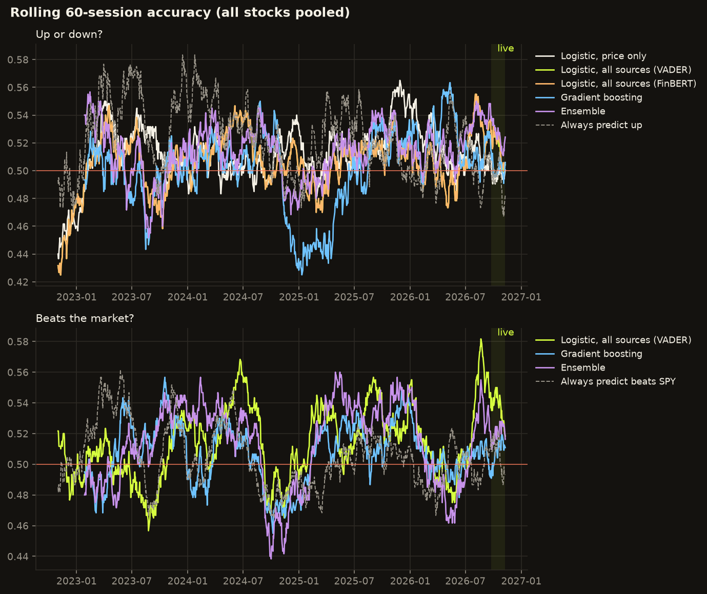
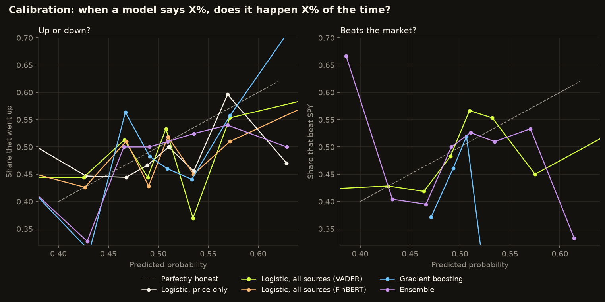
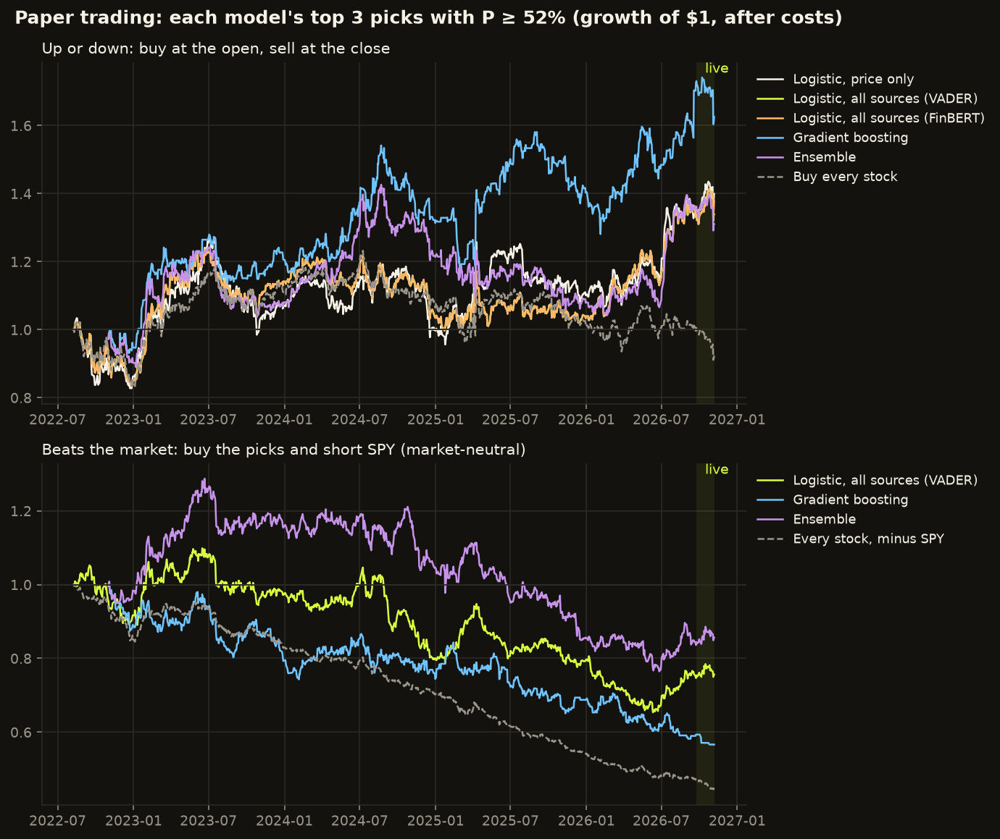

# Stock prediction lab: latest report

Generated 2026-11-04 07:30 UTC.

## Next-session calls

| Rank | Stock | P(up) | Call | P(beats SPY) | vs the market | Headlines (24 h) | Mood: VADER | Mood: FinBERT |
|---|---|---|---|---|---|---|---|---|
| 1 | TSLA | **66.6%** | **Buy at open** | 64.7% | **Outperform** | 37 | positive (+0.17) | neutral (+0.01) |
| 2 | META | **61.1%** | **Buy at open** | 53.6% | **Outperform** | 48 | neutral (+0.04) | neutral (-0.02) |
| 3 | AMZN | **60.6%** | **Buy at open** | 52.4% | – | 44 | positive (+0.09) | negative (-0.08) |
| 4 | AAPL | **58.3%** | Stay out | 53.2% | – | 76 | neutral (-0.01) | negative (-0.32) |
| 5 | XOM | **58.0%** | Stay out | 44.8% | – | 27 | positive (+0.13) | negative (-0.06) |
| 6 | NVDA | **47.6%** | Stay out | 44.5% | – | 65 | positive (+0.08) | neutral (-0.05) |
| 7 | GOOGL | **47.6%** | Stay out | 62.5% | **Outperform** | 44 | positive (+0.07) | negative (-0.14) |
| 8 | UNH | **45.8%** | Stay out | 38.9% | – | 10 | positive (+0.19) | positive (+0.39) |
| 9 | JPM | **45.1%** | Stay out | 47.8% | – | 33 | positive (+0.20) | neutral (+0.04) |
| 10 | MSFT | **44.6%** | Stay out | 50.2% | – | 39 | positive (+0.15) | neutral (-0.04) |

Every model's probability:

| Stock | P(up): logistic, price only | P(up): logistic, all sources (VADER) | P(up): logistic, all sources (FinBERT) | P(beats SPY): logistic, all sources (VADER) | P(up): gradient boosting | P(beats SPY): gradient boosting | P(up): ensemble | P(beats SPY): ensemble |
|---|---|---|---|---|---|---|---|---|
| AAPL | 49.5% | 57.9% | 58.3% | 53.2% | 48.9% | 50.3% | 53.4% | 51.7% |
| AMZN | 54.2% | 61.6% | 60.6% | 52.4% | 47.8% | 47.9% | 54.7% | 50.2% |
| GOOGL | 49.2% | 47.9% | 47.6% | 62.5% | 51.3% | 49.8% | 49.6% | 56.1% |
| JPM | 50.1% | 43.9% | 45.1% | 47.8% | 49.5% | 47.3% | 46.7% | 47.5% |
| META | 62.3% | 61.7% | 61.1% | 53.6% | 50.4% | 51.6% | 56.0% | 52.6% |
| MSFT | 47.9% | 42.9% | 44.6% | 50.2% | 48.2% | 50.7% | 45.5% | 50.4% |
| NVDA | 42.5% | 47.4% | 47.6% | 44.5% | 39.7% | 47.6% | 43.6% | 46.1% |
| TSLA | 54.0% | 67.9% | 66.6% | 64.7% | 48.9% | 50.3% | 58.4% | 57.5% |
| UNH | 48.3% | 47.8% | 45.8% | 38.9% | 50.3% | 47.3% | 49.0% | 43.1% |
| XOM | 60.1% | 57.0% | 58.0% | 44.8% | 48.2% | 50.9% | 52.6% | 47.8% |

## Accuracy: up or down?

| | Predictions | Accuracy | 95% range | Always up | Same as today | Beats baselines? | Brier |
|---|---|---|---|---|---|---|---|
| Live, logistic, price only | 280 | **52.5%** | 46.7%–58.3% | 46.8% | 48.2% | no | 0.2490 |
| Live, logistic, all sources (VADER) | 280 | **53.6%** | 47.7%–59.4% | 46.8% | 48.2% | within noise | 0.2518 |
| Live, logistic, all sources (FinBERT) | 280 | **53.9%** | 48.1%–59.8% | 46.8% | 48.2% | within noise | 0.2511 |
| Live, gradient boosting | 280 | **51.1%** | 45.2%–56.9% | 46.8% | 48.2% | no | 0.2498 |
| Live, ensemble | 280 | **52.9%** | 47.0%–58.7% | 46.8% | 48.2% | no | 0.2488 |
| Historical replay, logistic, price only | 10,348 | **51.0%** | 50.0%–51.9% | 52.2% | 49.8% | no | 0.2523 |
| Historical replay, logistic, all sources (VADER) | 10,348 | **50.4%** | 49.4%–51.4% | 52.2% | 49.8% | no | 0.2544 |
| Historical replay, logistic, all sources (FinBERT) | 10,348 | **50.4%** | 49.4%–51.4% | 52.2% | 49.8% | no | 0.2544 |
| Historical replay, gradient boosting | 9,758 | **50.1%** | 49.1%–51.1% | 52.4% | 49.8% | no | 0.2592 |
| Historical replay, ensemble | 9,758 | **51.5%** | 50.5%–52.5% | 52.4% | 49.8% | no | 0.2533 |

## Accuracy: beats the market?

| | Predictions | Accuracy | 95% range | Always beats | Same as today | Beats baselines? | Brier |
|---|---|---|---|---|---|---|---|
| Live, logistic, all sources (VADER) | 280 | **55.0%** | 49.2%–60.8% | 46.1% | 45.4% | within noise | 0.2519 |
| Live, gradient boosting | 280 | **54.3%** | 48.5%–60.1% | 46.1% | 45.4% | within noise | 0.2491 |
| Live, ensemble | 280 | **55.0%** | 49.2%–60.8% | 46.1% | 45.4% | within noise | 0.2488 |
| Historical replay, logistic, all sources (VADER) | 10,348 | **51.4%** | 50.4%–52.3% | 50.4% | 49.8% | within noise | 0.2542 |
| Historical replay, gradient boosting | 9,758 | **50.6%** | 49.6%–51.6% | 50.5% | 49.9% | within noise | 0.2544 |
| Historical replay, ensemble | 9,758 | **51.2%** | 50.2%–52.2% | 50.5% | 49.9% | within noise | 0.2520 |

*Brier* is the mean squared error of the probabilities (lower is better; always saying 50% scores 0.25).

## Calibration

Predictions grouped by confidence. For an honest model, the share that happened matches the prediction: of all the "55–60%" calls, about 57% should come true. *Average gap* is the weighted average distance between the two (expected calibration error). Uses live predictions once a model has 300, before that all scored ones.

**Up or down?**

| Predicted | Logistic, price only | Logistic, all sources (VADER) | Logistic, all sources (FinBERT) | Gradient boosting | Ensemble |
|---|---|---|---|---|---|
| under 40% | 53.1% (n=256) | 50.5% (n=639) | 50.5% (n=641) | 55.0% (n=1,055) | 51.9% (n=480) |
| 40–45% | 51.6% (n=824) | 51.6% (n=1,132) | 51.6% (n=1,132) | 53.7% (n=1,063) | 52.3% (n=968) |
| 45–48% | 50.6% (n=1,321) | 50.4% (n=1,266) | 50.4% (n=1,271) | 50.9% (n=1,146) | 48.9% (n=1,238) |
| 48–50% | 52.2% (n=1,343) | 55.1% (n=1,166) | 55.1% (n=1,164) | 50.0% (n=1,017) | 51.2% (n=1,177) |
| 50–52% | 52.5% (n=1,734) | 51.1% (n=1,262) | 51.0% (n=1,262) | 47.4% (n=1,142) | 53.5% (n=1,427) |
| 52–55% | 51.9% (n=2,364) | 51.7% (n=1,776) | 51.8% (n=1,771) | 52.3% (n=1,629) | 52.6% (n=2,021) |
| 55–60% | 52.8% (n=2,137) | 52.4% (n=2,125) | 52.4% (n=2,124) | 52.6% (n=1,564) | 54.5% (n=1,909) |
| 60% or more | 52.4% (n=649) | 53.3% (n=1,262) | 53.3% (n=1,263) | 54.9% (n=1,422) | 50.0% (n=818) |
| **Average gap** | **4.0 pts** | **5.5 pts** | **5.5 pts** | **7.0 pts** | **4.3 pts** |

**Beats the market?**

| Predicted | Logistic, all sources (VADER) | Gradient boosting | Ensemble |
|---|---|---|---|
| under 40% | 48.3% (n=961) | 49.7% (n=768) | 51.2% (n=430) |
| 40–45% | 46.7% (n=1,536) | 49.7% (n=1,260) | 47.3% (n=1,312) |
| 45–48% | 50.6% (n=1,466) | 49.8% (n=1,615) | 48.0% (n=1,741) |
| 48–50% | 49.7% (n=1,170) | 49.6% (n=1,512) | 51.4% (n=1,554) |
| 50–52% | 49.9% (n=1,208) | 50.7% (n=1,584) | 51.0% (n=1,494) |
| 52–55% | 52.3% (n=1,555) | 52.3% (n=1,575) | 50.9% (n=1,809) |
| 55–60% | 51.9% (n=1,689) | 50.0% (n=1,105) | 53.8% (n=1,326) |
| 60% or more | 52.5% (n=1,043) | 51.1% (n=619) | 50.5% (n=372) |
| **Average gap** | **4.6 pts** | **4.3 pts** | **3.1 pts** |

## Headline sentiment: VADER vs FinBERT

Every headline is scored by both. Two ways to compare them: the live accuracy of the two otherwise identical logistic models above (*all sources (VADER)* vs *all sources (FinBERT)*), and directly, below: does the mood predict the next session?

| Scorer | Stock-days with a clear mood | Mood matched the next session | Next-session return: positive mood | negative mood | Rank correlation with return |
|---|---|---|---|---|---|
| VADER | 240 | 47.5% | -0.2% | -0.2% | -0.060 |
| FinBERT | 191 | 47.6% | -0.1% | 0.2% | -0.107 |

The two scorers agree on the direction of the mood on 68% of 290 stock-days with headlines.

## Per stock: up or down?

Based on live predictions.

| Stock | Sessions | Logistic, price only | Logistic, all sources (VADER) | Logistic, all sources (FinBERT) | Gradient boosting | Ensemble | Always up |
|---|---|---|---|---|---|---|---|
| AAPL | 28 | 46.4% | 57.1% | 53.6% | 28.6% | 42.9% | 60.7% |
| AMZN | 28 | 57.1% | 57.1% | 57.1% | 53.6% | 50.0% | 50.0% |
| GOOGL | 28 | 64.3% | 57.1% | 57.1% | 67.9% | 78.6% | 42.9% |
| JPM | 28 | 46.4% | 39.3% | 46.4% | 35.7% | 32.1% | 35.7% |
| META | 28 | 46.4% | 57.1% | 53.6% | 64.3% | 60.7% | 39.3% |
| MSFT | 28 | 50.0% | 53.6% | 53.6% | 64.3% | 50.0% | 46.4% |
| NVDA | 28 | 50.0% | 53.6% | 53.6% | 57.1% | 53.6% | 28.6% |
| TSLA | 28 | 50.0% | 53.6% | 53.6% | 35.7% | 42.9% | 50.0% |
| UNH | 28 | 46.4% | 42.9% | 42.9% | 60.7% | 53.6% | 50.0% |
| XOM | 28 | 67.9% | 64.3% | 67.9% | 42.9% | 64.3% | 64.3% |

## Per stock: beats the market?

Based on live predictions.

| Stock | Sessions | Logistic, all sources (VADER) | Gradient boosting | Ensemble | Always beats |
|---|---|---|---|---|---|
| AAPL | 28 | 60.7% | 39.3% | 67.9% | 60.7% |
| AMZN | 28 | 50.0% | 60.7% | 50.0% | 53.6% |
| GOOGL | 28 | 53.6% | 67.9% | 50.0% | 42.9% |
| JPM | 28 | 46.4% | 60.7% | 46.4% | 42.9% |
| META | 28 | 60.7% | 35.7% | 53.6% | 35.7% |
| MSFT | 28 | 57.1% | 57.1% | 57.1% | 50.0% |
| NVDA | 28 | 50.0% | 46.4% | 50.0% | 32.1% |
| TSLA | 28 | 50.0% | 53.6% | 50.0% | 46.4% |
| UNH | 28 | 57.1% | 60.7% | 60.7% | 39.3% |
| XOM | 28 | 64.3% | 60.7% | 64.3% | 57.1% |

## Paper trading (simulated from prices)

Hypothetical: each session a strategy buys, at the open, the (up to) 3 stocks its model rates highest with P ≥ 52%, and sells them at the close, paying 5 bp per trade. The *beats the market* version also shorts the same amount of SPY, so it only earns the stocks' return above the market's (two trades, double cost).

**Up or down**

| Strategy | Sessions | Total return | Per year | Sharpe | Winning days |
|---|---|---|---|---|---|
| Top 3 by logistic, price only | 1,063 | +42.0% | +8.7% | 0.51 | 51.0% |
| Top 3 by logistic, all sources (VADER) | 1,063 | +38.9% | +8.1% | 0.51 | 50.4% |
| Top 3 by logistic, all sources (FinBERT) | 1,063 | +40.5% | +8.4% | 0.52 | 50.4% |
| Top 3 by gradient boosting | 1,004 | +68.7% | +14.0% | 0.78 | 36.8% |
| Top 3 by ensemble | 1,004 | +35.9% | +8.0% | 0.52 | 46.0% |
| Buy every stock, every session | 1,063 | -4.9% | -1.2% | 0.02 | 51.8% |

**Beats the market (market-neutral)**

| Strategy | Sessions | Total return | Per year | Sharpe | Winning days |
|---|---|---|---|---|---|
| Top 3 by logistic, all sources (VADER) | 1,063 | -23.5% | -6.2% | -0.38 | 46.8% |
| Top 3 by gradient boosting | 1,004 | -43.4% | -13.3% | -0.82 | 39.0% |
| Top 3 by ensemble | 1,004 | -13.4% | -3.5% | -0.15 | 46.2% |
| Every stock minus SPY | 1,063 | -55.3% | -17.4% | -2.48 | 42.1% |

## Paper orders at Alpaca (real fills)

No paper orders yet. Connect an Alpaca paper account (see the README) and the champion's picks are sent as real simulated orders every session.

## Data sources this run

| Source | Calls ok | Failed | Items | Note |
|---|---|---|---|---|
| alpaca | 0 | 0 | 0 | skipped: set ALPACA_API_KEY and ALPACA_SECRET_KEY to enable |
| analysts | 10 | 0 | 7838 |  |
| earnings | 10 | 0 | 500 |  |
| finbert | 10 | 0 | 266 |  |
| finnhub | 0 | 0 | 0 | skipped: set FINNHUB_API_KEY to enable |
| fred | 0 | 1 | 0 | ReadTimeout: HTTPSConnectionPool(host='fred.stlouisfed.org', port=443): Read timed out. (read timeout=20) |
| google_news | 10 | 0 | 914 |  |
| macro_yahoo | 1 | 0 | 1089 |  |
| major_news | 10 | 0 | 1000 |  |
| prices | 11 | 0 | 11957 |  |
| reddit | 0 | 0 | 0 | skipped: set REDDIT_CLIENT_ID and REDDIT_CLIENT_SECRET to enable |
| sec_filings | 0 | 0 | 0 | skipped: set SEC_USER_AGENT to enable |
| yahoo_rss | 10 | 0 | 181 |  |

## This run, per stock

| Stock | Status | Data through | History replayed | Scored today | Headlines (24 h) |
|---|---|---|---|---|---|
| AAPL | ok | 2026-11-03 | 0 | 0 | 0 |
| MSFT | ok | 2026-11-03 | 0 | 0 | 0 |
| NVDA | ok | 2026-11-03 | 0 | 0 | 0 |
| AMZN | ok | 2026-11-03 | 0 | 0 | 0 |
| GOOGL | ok | 2026-11-03 | 0 | 0 | 0 |
| META | ok | 2026-11-03 | 0 | 0 | 0 |
| TSLA | ok | 2026-11-03 | 0 | 0 | 0 |
| JPM | ok | 2026-11-03 | 0 | 0 | 0 |
| XOM | ok | 2026-11-03 | 0 | 0 | 0 |
| UNH | ok | 2026-11-03 | 0 | 0 | 0 |

---

Educational project. Not financial advice.
