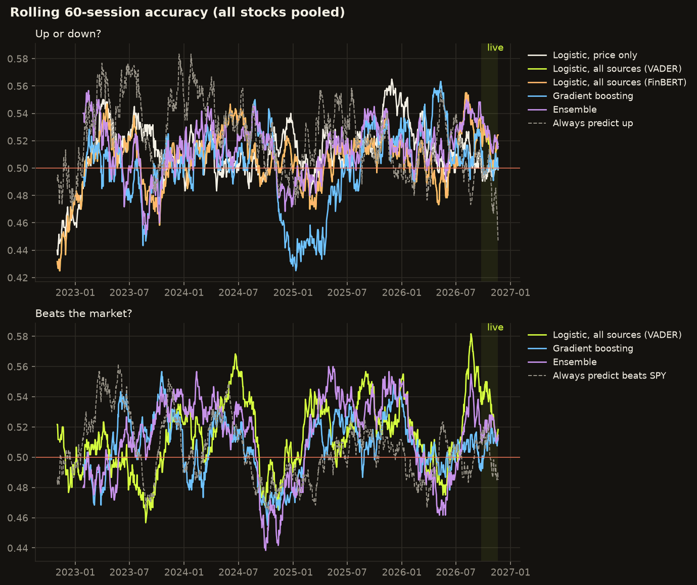

# Stock prediction lab: latest report

Generated 2026-11-20 08:32 UTC.

## Next-session calls

| Rank | Stock | P(up) | Call | P(beats SPY) | vs the market | Headlines (24 h) | Mood: VADER | Mood: FinBERT |
|---|---|---|---|---|---|---|---|---|
| 1 | TSLA | **58.4%** | **Buy at open** | 66.5% | **Outperform** | 37 | positive (+0.09) | neutral (+0.03) |
| 2 | AAPL | **55.3%** | **Buy at open** | 62.6% | **Outperform** | 39 | neutral (+0.04) | negative (-0.06) |
| 3 | AMZN | **54.4%** | **Buy at open** | 56.5% | – | 57 | positive (+0.24) | neutral (+0.02) |
| 4 | XOM | **53.9%** | Stay out | 58.8% | – | 29 | positive (+0.15) | neutral (+0.03) |
| 5 | UNH | **52.3%** | Stay out | 64.0% | **Outperform** | 43 | neutral (-0.03) | negative (-0.28) |
| 6 | MSFT | **51.3%** | Stay out | 42.2% | – | 47 | positive (+0.12) | positive (+0.06) |
| 7 | META | **50.2%** | Stay out | 39.8% | – | 55 | positive (+0.14) | negative (-0.13) |
| 8 | JPM | **46.5%** | Stay out | 44.1% | – | 31 | positive (+0.09) | negative (-0.25) |
| 9 | GOOGL | **44.7%** | Stay out | 47.0% | – | 49 | positive (+0.16) | neutral (-0.01) |
| 10 | NVDA | **36.6%** | Stay out | 22.9% | – | 83 | negative (-0.06) | negative (-0.24) |

Every model's probability:

| Stock | P(up): logistic, price only | P(up): logistic, all sources (VADER) | P(up): logistic, all sources (FinBERT) | P(beats SPY): logistic, all sources (VADER) | P(up): gradient boosting | P(beats SPY): gradient boosting | P(up): ensemble | P(beats SPY): ensemble |
|---|---|---|---|---|---|---|---|---|
| AAPL | 52.5% | 57.7% | 57.7% | 62.6% | 52.9% | 49.9% | 55.3% | 56.3% |
| AMZN | 53.4% | 51.9% | 53.6% | 56.5% | 56.9% | 50.5% | 54.4% | 53.5% |
| GOOGL | 39.6% | 33.1% | 33.0% | 47.0% | 56.3% | 50.5% | 44.7% | 48.8% |
| JPM | 52.3% | 40.5% | 37.1% | 44.1% | 52.6% | 50.5% | 46.5% | 47.3% |
| META | 50.2% | 42.1% | 43.0% | 39.8% | 58.3% | 48.9% | 50.2% | 44.4% |
| MSFT | 51.4% | 47.9% | 46.9% | 42.2% | 54.7% | 50.5% | 51.3% | 46.3% |
| NVDA | 29.7% | 20.9% | 21.4% | 22.9% | 52.4% | 50.5% | 36.6% | 36.7% |
| TSLA | 54.1% | 61.1% | 61.1% | 66.5% | 55.7% | 48.9% | 58.4% | 57.7% |
| UNH | 67.6% | 64.1% | 63.7% | 64.0% | 40.6% | 50.5% | 52.3% | 57.2% |
| XOM | 56.9% | 55.2% | 55.4% | 58.8% | 52.6% | 50.5% | 53.9% | 54.6% |

## Accuracy: up or down?

| | Predictions | Accuracy | 95% range | Always up | Same as today | Beats baselines? | Brier |
|---|---|---|---|---|---|---|---|
| Live, logistic, price only | 400 | **51.0%** | 46.1%–55.9% | 44.0% | 50.5% | no | 0.2510 |
| Live, logistic, all sources (VADER) | 400 | **53.0%** | 48.1%–57.9% | 44.0% | 50.5% | no | 0.2502 |
| Live, logistic, all sources (FinBERT) | 400 | **54.0%** | 49.1%–58.9% | 44.0% | 50.5% | no | 0.2493 |
| Live, gradient boosting | 400 | **52.8%** | 47.9%–57.6% | 44.0% | 50.5% | no | 0.2462 |
| Live, ensemble | 400 | **53.8%** | 48.9%–58.6% | 44.0% | 50.5% | no | 0.2458 |
| Historical replay, logistic, price only | 10,348 | **51.0%** | 50.0%–51.9% | 52.2% | 49.8% | no | 0.2523 |
| Historical replay, logistic, all sources (VADER) | 10,348 | **50.4%** | 49.4%–51.4% | 52.2% | 49.8% | no | 0.2544 |
| Historical replay, logistic, all sources (FinBERT) | 10,348 | **50.4%** | 49.4%–51.4% | 52.2% | 49.8% | no | 0.2544 |
| Historical replay, gradient boosting | 9,758 | **50.1%** | 49.1%–51.1% | 52.4% | 49.8% | no | 0.2592 |
| Historical replay, ensemble | 9,758 | **51.5%** | 50.5%–52.5% | 52.4% | 49.8% | no | 0.2533 |

## Accuracy: beats the market?

| | Predictions | Accuracy | 95% range | Always beats | Same as today | Beats baselines? | Brier |
|---|---|---|---|---|---|---|---|
| Live, logistic, all sources (VADER) | 400 | **54.5%** | 49.6%–59.4% | 46.5% | 47.8% | within noise | 0.2533 |
| Live, gradient boosting | 400 | **53.5%** | 48.6%–58.4% | 46.5% | 47.8% | within noise | 0.2493 |
| Live, ensemble | 400 | **54.2%** | 49.4%–59.1% | 46.5% | 47.8% | within noise | 0.2494 |
| Historical replay, logistic, all sources (VADER) | 10,348 | **51.4%** | 50.4%–52.3% | 50.4% | 49.8% | within noise | 0.2542 |
| Historical replay, gradient boosting | 9,758 | **50.6%** | 49.6%–51.6% | 50.5% | 49.9% | within noise | 0.2544 |
| Historical replay, ensemble | 9,758 | **51.2%** | 50.2%–52.2% | 50.5% | 49.9% | within noise | 0.2520 |

*Brier* is the mean squared error of the probabilities (lower is better; always saying 50% scores 0.25).

## Calibration

Predictions grouped by confidence. For an honest model, the share that happened matches the prediction: of all the "55–60%" calls, about 57% should come true. *Average gap* is the weighted average distance between the two (expected calibration error). Uses live predictions once a model has 300, before that all scored ones.

**Up or down?**

| Predicted | Logistic, price only | Logistic, all sources (VADER) | Logistic, all sources (FinBERT) | Gradient boosting | Ensemble |
|---|---|---|---|---|---|
| under 40% | 40.0% (n=15) | 38.2% (n=55) | 38.6% (n=57) | 37.5% (n=8) | 27.3% (n=11) |
| 40–45% | 41.5% (n=53) | 42.9% (n=70) | 39.1% (n=69) | 24.5% (n=53) | 28.1% (n=64) |
| 45–48% | 39.3% (n=61) | 45.5% (n=44) | 49.1% (n=53) | 50.8% (n=63) | 47.1% (n=68) |
| 48–50% | 46.8% (n=47) | 39.5% (n=43) | 36.6% (n=41) | 44.4% (n=63) | 48.2% (n=56) |
| 50–52% | 46.2% (n=52) | 51.5% (n=33) | 50.0% (n=28) | 43.2% (n=74) | 42.2% (n=64) |
| 52–55% | 42.0% (n=88) | 32.1% (n=53) | 41.3% (n=46) | 40.8% (n=71) | 49.3% (n=69) |
| 55–60% | 51.6% (n=62) | 49.1% (n=57) | 45.0% (n=60) | 53.7% (n=54) | 51.9% (n=52) |
| 60% or more | 40.9% (n=22) | 57.8% (n=45) | 56.5% (n=46) | 71.4% (n=14) | 50.0% (n=16) |
| **Average gap** | **6.8 pts** | **6.5 pts** | **7.0 pts** | **8.2 pts** | **6.1 pts** |

**Beats the market?**

| Predicted | Logistic, all sources (VADER) | Gradient boosting | Ensemble |
|---|---|---|---|
| under 40% | 40.4% (n=52) | – | 50.0% (n=8) |
| 40–45% | 42.3% (n=78) | – | 39.6% (n=53) |
| 45–48% | 42.0% (n=50) | 36.1% (n=36) | 40.0% (n=90) |
| 48–50% | 46.7% (n=30) | 44.6% (n=166) | 48.5% (n=66) |
| 50–52% | 55.9% (n=34) | 50.3% (n=191) | 53.8% (n=65) |
| 52–55% | 58.2% (n=55) | 42.9% (n=7) | 50.8% (n=63) |
| 55–60% | 42.9% (n=49) | – | 49.0% (n=51) |
| 60% or more | 48.1% (n=52) | – | 25.0% (n=4) |
| **Average gap** | **6.4 pts** | **3.3 pts** | **4.6 pts** |

## Headline sentiment: VADER vs FinBERT

Every headline is scored by both. Two ways to compare them: the live accuracy of the two otherwise identical logistic models above (*all sources (VADER)* vs *all sources (FinBERT)*), and directly, below: does the mood predict the next session?

| Scorer | Stock-days with a clear mood | Mood matched the next session | Next-session return: positive mood | negative mood | Rank correlation with return |
|---|---|---|---|---|---|
| VADER | 336 | 46.1% | -0.3% | -1.0% | -0.030 |
| FinBERT | 266 | 49.6% | -0.2% | -0.4% | +0.022 |

The two scorers agree on the direction of the mood on 64% of 410 stock-days with headlines.

## Per stock: up or down?

Based on live predictions.

| Stock | Sessions | Logistic, price only | Logistic, all sources (VADER) | Logistic, all sources (FinBERT) | Gradient boosting | Ensemble | Always up |
|---|---|---|---|---|---|---|---|
| AAPL | 40 | 40.0% | 52.5% | 52.5% | 40.0% | 50.0% | 55.0% |
| AMZN | 40 | 60.0% | 55.0% | 55.0% | 45.0% | 45.0% | 45.0% |
| GOOGL | 40 | 60.0% | 57.5% | 57.5% | 65.0% | 75.0% | 37.5% |
| JPM | 40 | 47.5% | 47.5% | 57.5% | 35.0% | 37.5% | 35.0% |
| META | 40 | 45.0% | 55.0% | 52.5% | 57.5% | 57.5% | 37.5% |
| MSFT | 40 | 47.5% | 52.5% | 52.5% | 65.0% | 50.0% | 47.5% |
| NVDA | 40 | 57.5% | 60.0% | 60.0% | 60.0% | 62.5% | 27.5% |
| TSLA | 40 | 50.0% | 55.0% | 55.0% | 47.5% | 50.0% | 50.0% |
| UNH | 40 | 47.5% | 42.5% | 42.5% | 60.0% | 52.5% | 47.5% |
| XOM | 40 | 55.0% | 52.5% | 55.0% | 52.5% | 57.5% | 57.5% |

## Per stock: beats the market?

Based on live predictions.

| Stock | Sessions | Logistic, all sources (VADER) | Gradient boosting | Ensemble | Always beats |
|---|---|---|---|---|---|
| AAPL | 40 | 62.5% | 47.5% | 67.5% | 67.5% |
| AMZN | 40 | 47.5% | 55.0% | 47.5% | 47.5% |
| GOOGL | 40 | 52.5% | 62.5% | 50.0% | 42.5% |
| JPM | 40 | 47.5% | 57.5% | 47.5% | 40.0% |
| META | 40 | 55.0% | 40.0% | 50.0% | 35.0% |
| MSFT | 40 | 57.5% | 52.5% | 57.5% | 47.5% |
| NVDA | 40 | 57.5% | 47.5% | 57.5% | 30.0% |
| TSLA | 40 | 55.0% | 60.0% | 55.0% | 52.5% |
| UNH | 40 | 50.0% | 55.0% | 50.0% | 42.5% |
| XOM | 40 | 60.0% | 57.5% | 60.0% | 60.0% |

## Paper trading (simulated from prices)

Hypothetical: each session a strategy buys, at the open, the (up to) 3 stocks its model rates highest with P ≥ 52%, and sells them at the close, paying 5 bp per trade. The *beats the market* version also shorts the same amount of SPY, so it only earns the stocks' return above the market's (two trades, double cost).

**Up or down**

| Strategy | Sessions | Total return | Per year | Sharpe | Winning days |
|---|---|---|---|---|---|
| Top 3 by logistic, price only | 1,075 | +24.3% | +5.2% | 0.35 | 50.7% |
| Top 3 by logistic, all sources (VADER) | 1,075 | +22.3% | +4.8% | 0.34 | 50.2% |
| Top 3 by logistic, all sources (FinBERT) | 1,075 | +22.8% | +4.9% | 0.35 | 50.1% |
| Top 3 by gradient boosting | 1,016 | +53.5% | +11.2% | 0.64 | 36.8% |
| Top 3 by ensemble | 1,016 | +8.8% | +2.1% | 0.20 | 45.9% |
| Buy every stock, every session | 1,075 | -15.0% | -3.7% | -0.12 | 51.7% |

**Beats the market (market-neutral)**

| Strategy | Sessions | Total return | Per year | Sharpe | Winning days |
|---|---|---|---|---|---|
| Top 3 by logistic, all sources (VADER) | 1,075 | -25.7% | -6.7% | -0.41 | 46.8% |
| Top 3 by gradient boosting | 1,016 | -43.6% | -13.2% | -0.82 | 38.7% |
| Top 3 by ensemble | 1,016 | -15.7% | -4.2% | -0.19 | 46.2% |
| Every stock minus SPY | 1,075 | -57.1% | -18.0% | -2.57 | 41.9% |

## Paper orders at Alpaca (real fills)

No paper orders yet. Connect an Alpaca paper account (see the README) and the champion's picks are sent as real simulated orders every session.

## Data sources this run

| Source | Calls ok | Failed | Items | Note |
|---|---|---|---|---|
| alpaca | 0 | 0 | 0 | skipped: set ALPACA_API_KEY and ALPACA_SECRET_KEY to enable |
| analysts | 10 | 0 | 7828 |  |
| earnings | 10 | 0 | 500 |  |
| finbert | 10 | 0 | 225 |  |
| finnhub | 0 | 0 | 0 | skipped: set FINNHUB_API_KEY to enable |
| fred | 0 | 1 | 0 | ReadTimeout: HTTPSConnectionPool(host='fred.stlouisfed.org', port=443): Read timed out. (read timeout=20) |
| google_news | 10 | 0 | 939 |  |
| macro_yahoo | 1 | 0 | 1090 |  |
| major_news | 10 | 0 | 1000 |  |
| prices | 11 | 0 | 11957 |  |
| reddit | 0 | 0 | 0 | skipped: set REDDIT_CLIENT_ID and REDDIT_CLIENT_SECRET to enable |
| sec_filings | 0 | 0 | 0 | skipped: set SEC_USER_AGENT to enable |
| yahoo_rss | 10 | 0 | 181 |  |

## This run, per stock

| Stock | Status | Data through | History replayed | Scored today | Headlines (24 h) |
|---|---|---|---|---|---|
| AAPL | ok | 2026-11-19 | 0 | 0 | 0 |
| MSFT | ok | 2026-11-19 | 0 | 0 | 0 |
| NVDA | ok | 2026-11-19 | 0 | 0 | 0 |
| AMZN | ok | 2026-11-19 | 0 | 0 | 0 |
| GOOGL | ok | 2026-11-19 | 0 | 0 | 0 |
| META | ok | 2026-11-19 | 0 | 0 | 0 |
| TSLA | ok | 2026-11-19 | 0 | 0 | 0 |
| JPM | ok | 2026-11-19 | 0 | 0 | 0 |
| XOM | ok | 2026-11-19 | 0 | 0 | 0 |
| UNH | ok | 2026-11-19 | 0 | 0 | 0 |

---

Educational project. Not financial advice.
