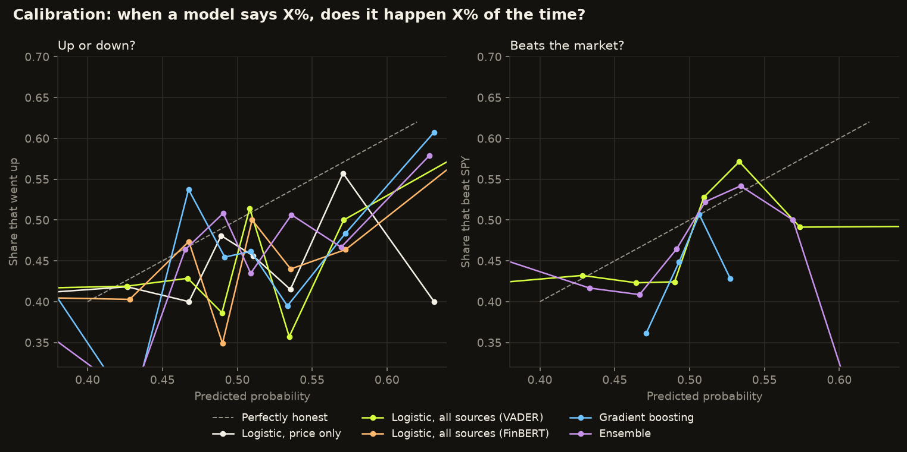

# Stock prediction lab: latest report

Generated 2026-11-19 08:47 UTC.

## Next-session calls

| Rank | Stock | P(up) | Call | P(beats SPY) | vs the market | Headlines (24 h) | Mood: VADER | Mood: FinBERT |
|---|---|---|---|---|---|---|---|---|
| 1 | UNH | **54.5%** | **Buy at open** | 73.7% | **Outperform** | 38 | negative (-0.08) | negative (-0.41) |
| 2 | XOM | **50.2%** | Stay out | 60.6% | **Outperform** | 31 | positive (+0.14) | neutral (+0.00) |
| 3 | AAPL | **48.8%** | Stay out | 52.9% | – | 35 | positive (+0.24) | positive (+0.07) |
| 4 | TSLA | **45.8%** | Stay out | 62.8% | **Outperform** | 31 | positive (+0.10) | positive (+0.16) |
| 5 | JPM | **45.7%** | Stay out | 39.8% | – | 27 | positive (+0.11) | negative (-0.33) |
| 6 | META | **44.6%** | Stay out | 42.6% | – | 40 | neutral (+0.02) | negative (-0.11) |
| 7 | AMZN | **43.9%** | Stay out | 39.0% | – | 57 | positive (+0.19) | neutral (-0.00) |
| 8 | MSFT | **43.6%** | Stay out | 47.2% | – | 48 | positive (+0.15) | neutral (-0.01) |
| 9 | NVDA | **38.7%** | Stay out | 37.3% | – | 92 | neutral (+0.04) | negative (-0.06) |
| 10 | GOOGL | **36.2%** | Stay out | 57.4% | – | 41 | positive (+0.11) | negative (-0.06) |

Every model's probability:

| Stock | P(up): logistic, price only | P(up): logistic, all sources (VADER) | P(up): logistic, all sources (FinBERT) | P(beats SPY): logistic, all sources (VADER) | P(up): gradient boosting | P(beats SPY): gradient boosting | P(up): ensemble | P(beats SPY): ensemble |
|---|---|---|---|---|---|---|---|---|
| AAPL | 55.1% | 55.1% | 59.3% | 52.9% | 42.6% | 50.3% | 48.8% | 51.6% |
| AMZN | 48.0% | 44.1% | 44.7% | 39.0% | 43.8% | 50.5% | 43.9% | 44.7% |
| GOOGL | 41.5% | 30.1% | 29.0% | 57.4% | 42.3% | 48.6% | 36.2% | 53.0% |
| JPM | 55.4% | 41.2% | 36.9% | 39.8% | 50.2% | 50.2% | 45.7% | 45.0% |
| META | 55.6% | 48.7% | 48.1% | 42.6% | 40.4% | 49.7% | 44.6% | 46.1% |
| MSFT | 51.0% | 44.3% | 43.5% | 47.2% | 43.0% | 50.2% | 43.6% | 48.7% |
| NVDA | 38.7% | 31.4% | 32.2% | 37.3% | 46.1% | 50.2% | 38.7% | 43.7% |
| TSLA | 49.3% | 51.2% | 51.6% | 62.8% | 40.4% | 48.5% | 45.8% | 55.6% |
| UNH | 73.4% | 71.7% | 71.8% | 73.7% | 37.3% | 48.3% | 54.5% | 61.0% |
| XOM | 54.2% | 53.4% | 53.7% | 60.6% | 47.1% | 50.2% | 50.2% | 55.4% |

## Accuracy: up or down?

| | Predictions | Accuracy | 95% range | Always up | Same as today | Beats baselines? | Brier |
|---|---|---|---|---|---|---|---|
| Live, logistic, price only | 390 | **51.3%** | 46.3%–56.2% | 45.1% | 50.0% | no | 0.2503 |
| Live, logistic, all sources (VADER) | 390 | **52.8%** | 47.9%–57.8% | 45.1% | 50.0% | no | 0.2505 |
| Live, logistic, all sources (FinBERT) | 390 | **53.8%** | 48.9%–58.8% | 45.1% | 50.0% | no | 0.2497 |
| Live, gradient boosting | 390 | **51.8%** | 46.8%–56.8% | 45.1% | 50.0% | no | 0.2477 |
| Live, ensemble | 390 | **53.1%** | 48.1%–58.0% | 45.1% | 50.0% | no | 0.2468 |
| Historical replay, logistic, price only | 10,348 | **51.0%** | 50.0%–51.9% | 52.2% | 49.8% | no | 0.2523 |
| Historical replay, logistic, all sources (VADER) | 10,348 | **50.4%** | 49.4%–51.4% | 52.2% | 49.8% | no | 0.2544 |
| Historical replay, logistic, all sources (FinBERT) | 10,348 | **50.4%** | 49.4%–51.4% | 52.2% | 49.8% | no | 0.2544 |
| Historical replay, gradient boosting | 9,758 | **50.1%** | 49.1%–51.1% | 52.4% | 49.8% | no | 0.2592 |
| Historical replay, ensemble | 9,758 | **51.5%** | 50.5%–52.5% | 52.4% | 49.8% | no | 0.2533 |

## Accuracy: beats the market?

| | Predictions | Accuracy | 95% range | Always beats | Same as today | Beats baselines? | Brier |
|---|---|---|---|---|---|---|---|
| Live, logistic, all sources (VADER) | 390 | **54.4%** | 49.4%–59.3% | 46.9% | 47.9% | within noise | 0.2529 |
| Live, gradient boosting | 390 | **53.1%** | 48.1%–58.0% | 46.9% | 47.9% | no | 0.2494 |
| Live, ensemble | 390 | **54.1%** | 49.2%–59.0% | 46.9% | 47.9% | within noise | 0.2493 |
| Historical replay, logistic, all sources (VADER) | 10,348 | **51.4%** | 50.4%–52.3% | 50.4% | 49.8% | within noise | 0.2542 |
| Historical replay, gradient boosting | 9,758 | **50.6%** | 49.6%–51.6% | 50.5% | 49.9% | within noise | 0.2544 |
| Historical replay, ensemble | 9,758 | **51.2%** | 50.2%–52.2% | 50.5% | 49.9% | within noise | 0.2520 |

*Brier* is the mean squared error of the probabilities (lower is better; always saying 50% scores 0.25).

## Calibration

Predictions grouped by confidence. For an honest model, the share that happened matches the prediction: of all the "55–60%" calls, about 57% should come true. *Average gap* is the weighted average distance between the two (expected calibration error). Uses live predictions once a model has 300, before that all scored ones.

**Up or down?**

| Predicted | Logistic, price only | Logistic, all sources (VADER) | Logistic, all sources (FinBERT) | Gradient boosting | Ensemble |
|---|---|---|---|---|---|
| under 40% | 42.9% (n=14) | 39.6% (n=53) | 40.7% (n=54) | 42.9% (n=7) | 33.3% (n=9) |
| 40–45% | 42.3% (n=52) | 44.8% (n=67) | 40.3% (n=67) | 27.7% (n=47) | 29.5% (n=61) |
| 45–48% | 40.0% (n=60) | 45.5% (n=44) | 49.1% (n=53) | 52.5% (n=61) | 48.5% (n=66) |
| 48–50% | 47.8% (n=46) | 40.5% (n=42) | 37.5% (n=40) | 44.4% (n=63) | 49.1% (n=55) |
| 50–52% | 47.1% (n=51) | 53.1% (n=32) | 51.9% (n=27) | 43.8% (n=73) | 42.9% (n=63) |
| 52–55% | 42.5% (n=87) | 32.7% (n=52) | 42.2% (n=45) | 40.8% (n=71) | 50.0% (n=68) |
| 55–60% | 54.2% (n=59) | 50.0% (n=56) | 45.8% (n=59) | 53.7% (n=54) | 51.9% (n=52) |
| 60% or more | 42.9% (n=21) | 59.1% (n=44) | 57.8% (n=45) | 71.4% (n=14) | 50.0% (n=16) |
| **Average gap** | **5.9 pts** | **6.7 pts** | **6.6 pts** | **8.0 pts** | **5.6 pts** |

**Beats the market?**

| Predicted | Logistic, all sources (VADER) | Gradient boosting | Ensemble |
|---|---|---|---|
| under 40% | 40.8% (n=49) | – | 50.0% (n=8) |
| 40–45% | 42.9% (n=77) | – | 40.0% (n=50) |
| 45–48% | 42.9% (n=49) | 36.1% (n=36) | 40.4% (n=89) |
| 48–50% | 46.7% (n=30) | 45.7% (n=162) | 49.2% (n=65) |
| 50–52% | 55.9% (n=34) | 50.3% (n=185) | 53.1% (n=64) |
| 52–55% | 57.4% (n=54) | 42.9% (n=7) | 51.6% (n=62) |
| 55–60% | 43.8% (n=48) | – | 49.0% (n=49) |
| 60% or more | 49.0% (n=49) | – | 33.3% (n=3) |
| **Average gap** | **5.9 pts** | **2.9 pts** | **3.9 pts** |

## Headline sentiment: VADER vs FinBERT

Every headline is scored by both. Two ways to compare them: the live accuracy of the two otherwise identical logistic models above (*all sources (VADER)* vs *all sources (FinBERT)*), and directly, below: does the mood predict the next session?

| Scorer | Stock-days with a clear mood | Mood matched the next session | Next-session return: positive mood | negative mood | Rank correlation with return |
|---|---|---|---|---|---|
| VADER | 328 | 47.0% | -0.3% | -0.6% | -0.037 |
| FinBERT | 259 | 49.0% | -0.2% | -0.2% | -0.000 |

The two scorers agree on the direction of the mood on 64% of 400 stock-days with headlines.

## Per stock: up or down?

Based on live predictions.

| Stock | Sessions | Logistic, price only | Logistic, all sources (VADER) | Logistic, all sources (FinBERT) | Gradient boosting | Ensemble | Always up |
|---|---|---|---|---|---|---|---|
| AAPL | 39 | 41.0% | 53.8% | 53.8% | 38.5% | 48.7% | 56.4% |
| AMZN | 39 | 59.0% | 53.8% | 53.8% | 43.6% | 43.6% | 46.2% |
| GOOGL | 39 | 59.0% | 56.4% | 56.4% | 64.1% | 74.4% | 38.5% |
| JPM | 39 | 48.7% | 46.2% | 56.4% | 35.9% | 35.9% | 35.9% |
| META | 39 | 46.2% | 53.8% | 51.3% | 56.4% | 56.4% | 38.5% |
| MSFT | 39 | 48.7% | 51.3% | 51.3% | 64.1% | 48.7% | 48.7% |
| NVDA | 39 | 56.4% | 59.0% | 59.0% | 59.0% | 61.5% | 28.2% |
| TSLA | 39 | 48.7% | 56.4% | 56.4% | 46.2% | 48.7% | 51.3% |
| UNH | 39 | 48.7% | 43.6% | 43.6% | 59.0% | 53.8% | 48.7% |
| XOM | 39 | 56.4% | 53.8% | 56.4% | 51.3% | 59.0% | 59.0% |

## Per stock: beats the market?

Based on live predictions.

| Stock | Sessions | Logistic, all sources (VADER) | Gradient boosting | Ensemble | Always beats |
|---|---|---|---|---|---|
| AAPL | 39 | 61.5% | 46.2% | 66.7% | 66.7% |
| AMZN | 39 | 46.2% | 56.4% | 46.2% | 48.7% |
| GOOGL | 39 | 53.8% | 61.5% | 51.3% | 43.6% |
| JPM | 39 | 48.7% | 56.4% | 48.7% | 38.5% |
| META | 39 | 53.8% | 38.5% | 48.7% | 35.9% |
| MSFT | 39 | 56.4% | 53.8% | 56.4% | 48.7% |
| NVDA | 39 | 56.4% | 48.7% | 56.4% | 30.8% |
| TSLA | 39 | 56.4% | 59.0% | 56.4% | 53.8% |
| UNH | 39 | 51.3% | 53.8% | 51.3% | 43.6% |
| XOM | 39 | 59.0% | 56.4% | 59.0% | 59.0% |

## Paper trading (simulated from prices)

Hypothetical: each session a strategy buys, at the open, the (up to) 3 stocks its model rates highest with P ≥ 52%, and sells them at the close, paying 5 bp per trade. The *beats the market* version also shorts the same amount of SPY, so it only earns the stocks' return above the market's (two trades, double cost).

**Up or down**

| Strategy | Sessions | Total return | Per year | Sharpe | Winning days |
|---|---|---|---|---|---|
| Top 3 by logistic, price only | 1,074 | +29.8% | +6.3% | 0.40 | 50.7% |
| Top 3 by logistic, all sources (VADER) | 1,074 | +25.9% | +5.6% | 0.38 | 50.3% |
| Top 3 by logistic, all sources (FinBERT) | 1,074 | +26.4% | +5.7% | 0.38 | 50.2% |
| Top 3 by gradient boosting | 1,015 | +53.5% | +11.2% | 0.64 | 36.8% |
| Top 3 by ensemble | 1,015 | +15.6% | +3.7% | 0.29 | 45.9% |
| Buy every stock, every session | 1,074 | -11.4% | -2.8% | -0.07 | 51.8% |

**Beats the market (market-neutral)**

| Strategy | Sessions | Total return | Per year | Sharpe | Winning days |
|---|---|---|---|---|---|
| Top 3 by logistic, all sources (VADER) | 1,074 | -24.9% | -6.5% | -0.39 | 46.8% |
| Top 3 by gradient boosting | 1,015 | -43.6% | -13.3% | -0.82 | 38.7% |
| Top 3 by ensemble | 1,015 | -15.0% | -4.0% | -0.18 | 46.2% |
| Every stock minus SPY | 1,074 | -56.6% | -17.8% | -2.54 | 41.9% |

## Paper orders at Alpaca (real fills)

No paper orders yet. Connect an Alpaca paper account (see the README) and the champion's picks are sent as real simulated orders every session.

## Data sources this run

| Source | Calls ok | Failed | Items | Note |
|---|---|---|---|---|
| alpaca | 0 | 0 | 0 | skipped: set ALPACA_API_KEY and ALPACA_SECRET_KEY to enable |
| analysts | 10 | 0 | 7828 |  |
| earnings | 10 | 0 | 500 |  |
| finbert | 10 | 0 | 310 |  |
| finnhub | 0 | 0 | 0 | skipped: set FINNHUB_API_KEY to enable |
| fred | 0 | 1 | 0 | ReadTimeout: HTTPSConnectionPool(host='fred.stlouisfed.org', port=443): Read timed out. (read timeout=20) |
| google_news | 10 | 0 | 874 |  |
| macro_yahoo | 1 | 0 | 1090 |  |
| major_news | 10 | 0 | 1000 |  |
| prices | 11 | 0 | 11957 |  |
| reddit | 0 | 0 | 0 | skipped: set REDDIT_CLIENT_ID and REDDIT_CLIENT_SECRET to enable |
| sec_filings | 0 | 0 | 0 | skipped: set SEC_USER_AGENT to enable |
| yahoo_rss | 10 | 0 | 185 |  |

## This run, per stock

| Stock | Status | Data through | History replayed | Scored today | Headlines (24 h) |
|---|---|---|---|---|---|
| AAPL | ok | 2026-11-18 | 0 | 0 | 0 |
| MSFT | ok | 2026-11-18 | 0 | 0 | 0 |
| NVDA | ok | 2026-11-18 | 0 | 0 | 0 |
| AMZN | ok | 2026-11-18 | 0 | 0 | 0 |
| GOOGL | ok | 2026-11-18 | 0 | 0 | 0 |
| META | ok | 2026-11-18 | 0 | 0 | 0 |
| TSLA | ok | 2026-11-18 | 0 | 0 | 0 |
| JPM | ok | 2026-11-18 | 0 | 0 | 0 |
| XOM | ok | 2026-11-18 | 0 | 0 | 0 |
| UNH | ok | 2026-11-18 | 0 | 0 | 0 |

---

Educational project. Not financial advice.
