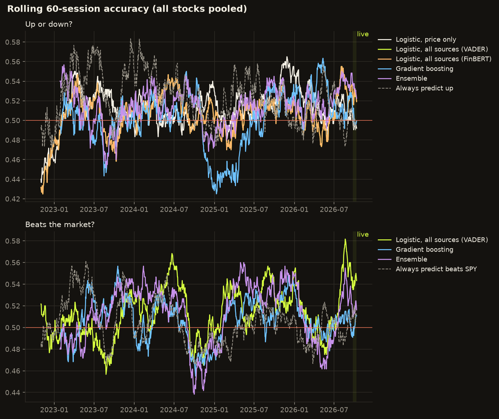
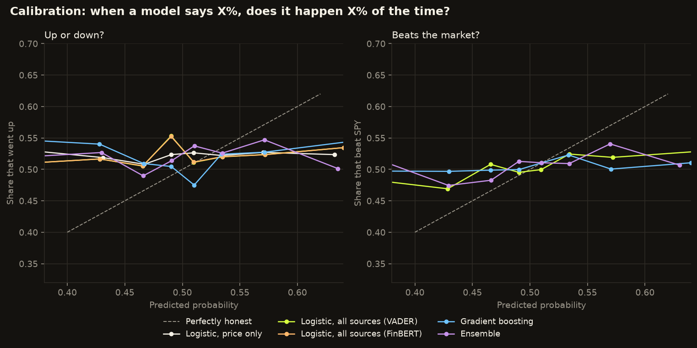
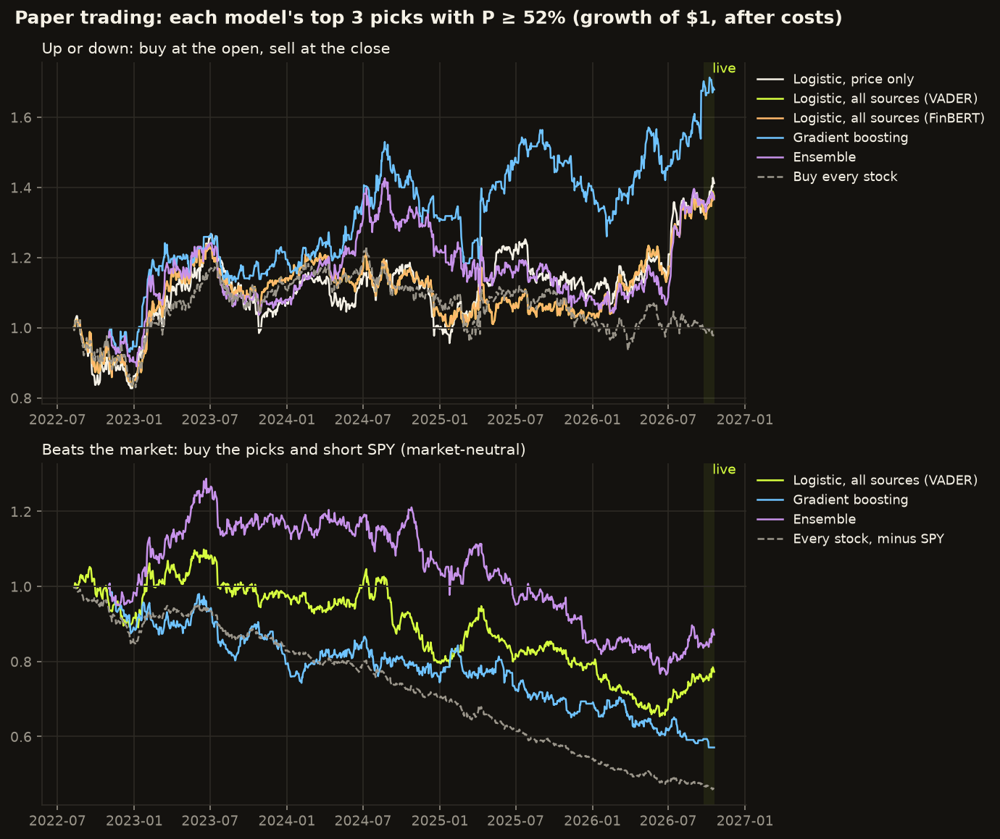

# Stock prediction lab: latest report

Generated 2026-10-29 01:49 UTC.

## Next-session calls

| Rank | Stock | P(up) | Call | P(beats SPY) | vs the market | Headlines (24 h) | Mood: VADER | Mood: FinBERT |
|---|---|---|---|---|---|---|---|---|
| 1 | NVDA | **57.0%** | **Buy at open** | 59.7% | **Outperform** | 72 | positive (+0.18) | neutral (-0.02) |
| 2 | TSLA | **55.9%** | **Buy at open** | 58.5% | **Outperform** | 26 | neutral (+0.03) | positive (+0.07) |
| 3 | AAPL | **52.4%** | **Buy at open** | 57.5% | **Outperform** | 35 | positive (+0.08) | neutral (+0.02) |
| 4 | META | **51.6%** | Stay out | 51.9% | – | 48 | positive (+0.06) | neutral (+0.04) |
| 5 | JPM | **51.4%** | Stay out | 46.5% | – | 27 | positive (+0.10) | neutral (+0.03) |
| 6 | XOM | **51.0%** | Stay out | 45.7% | – | 28 | neutral (+0.04) | positive (+0.06) |
| 7 | UNH | **50.5%** | Stay out | 41.7% | – | 6 | positive (+0.08) | positive (+0.52) |
| 8 | AMZN | **49.7%** | Stay out | 47.9% | – | 38 | positive (+0.18) | positive (+0.18) |
| 9 | GOOGL | **36.2%** | Stay out | 26.0% | – | 71 | negative (-0.09) | negative (-0.38) |
| 10 | MSFT | **34.8%** | Stay out | 32.5% | – | 58 | positive (+0.10) | positive (+0.07) |

Every model's probability:

| Stock | P(up): logistic, price only | P(up): logistic, all sources (VADER) | P(up): logistic, all sources (FinBERT) | P(beats SPY): logistic, all sources (VADER) | P(up): gradient boosting | P(beats SPY): gradient boosting | P(up): ensemble | P(beats SPY): ensemble |
|---|---|---|---|---|---|---|---|---|
| AAPL | 51.5% | 55.3% | 54.6% | 57.5% | 49.6% | 50.0% | 52.4% | 53.8% |
| AMZN | 48.9% | 48.9% | 47.7% | 47.9% | 50.4% | 49.7% | 49.7% | 48.8% |
| GOOGL | 47.7% | 34.5% | 29.8% | 26.0% | 37.9% | 47.3% | 36.2% | 36.6% |
| JPM | 49.0% | 48.9% | 48.9% | 46.5% | 53.9% | 47.6% | 51.4% | 47.1% |
| META | 49.3% | 50.7% | 50.0% | 51.9% | 52.5% | 49.9% | 51.6% | 50.9% |
| MSFT | 43.0% | 29.4% | 29.0% | 32.5% | 40.3% | 46.9% | 34.8% | 39.7% |
| NVDA | 53.1% | 56.9% | 56.8% | 59.7% | 57.1% | 50.1% | 57.0% | 54.9% |
| TSLA | 48.2% | 59.1% | 60.4% | 58.5% | 52.7% | 50.0% | 55.9% | 54.2% |
| UNH | 50.9% | 50.9% | 51.1% | 41.7% | 50.1% | 48.5% | 50.5% | 45.1% |
| XOM | 52.0% | 52.9% | 52.3% | 45.7% | 49.0% | 49.6% | 51.0% | 47.7% |

## Accuracy: up or down?

| | Predictions | Accuracy | 95% range | Always up | Same as today | Beats baselines? | Brier |
|---|---|---|---|---|---|---|---|
| Live, logistic, price only | 240 | **52.1%** | 45.8%–58.4% | 49.6% | 47.1% | within noise | 0.2498 |
| Live, logistic, all sources (VADER) | 240 | **53.3%** | 47.0%–59.6% | 49.6% | 47.1% | within noise | 0.2523 |
| Live, logistic, all sources (FinBERT) | 240 | **53.8%** | 47.4%–60.1% | 49.6% | 47.1% | within noise | 0.2521 |
| Live, gradient boosting | 240 | **50.8%** | 44.5%–57.2% | 49.6% | 47.1% | within noise | 0.2502 |
| Live, ensemble | 240 | **52.9%** | 46.6%–59.2% | 49.6% | 47.1% | within noise | 0.2492 |
| Historical replay, logistic, price only | 10,348 | **51.0%** | 50.0%–51.9% | 52.2% | 49.8% | no | 0.2523 |
| Historical replay, logistic, all sources (VADER) | 10,348 | **50.4%** | 49.4%–51.4% | 52.2% | 49.8% | no | 0.2544 |
| Historical replay, logistic, all sources (FinBERT) | 10,348 | **50.4%** | 49.4%–51.4% | 52.2% | 49.8% | no | 0.2544 |
| Historical replay, gradient boosting | 9,758 | **50.1%** | 49.1%–51.1% | 52.4% | 49.8% | no | 0.2592 |
| Historical replay, ensemble | 9,758 | **51.5%** | 50.5%–52.5% | 52.4% | 49.8% | no | 0.2533 |

## Accuracy: beats the market?

| | Predictions | Accuracy | 95% range | Always beats | Same as today | Beats baselines? | Brier |
|---|---|---|---|---|---|---|---|
| Live, logistic, all sources (VADER) | 240 | **55.0%** | 48.7%–61.3% | 46.7% | 45.8% | within noise | 0.2505 |
| Live, gradient boosting | 240 | **55.0%** | 48.7%–61.3% | 46.7% | 45.8% | within noise | 0.2490 |
| Live, ensemble | 240 | **54.6%** | 48.3%–60.9% | 46.7% | 45.8% | within noise | 0.2481 |
| Historical replay, logistic, all sources (VADER) | 10,348 | **51.4%** | 50.4%–52.3% | 50.4% | 49.8% | within noise | 0.2542 |
| Historical replay, gradient boosting | 9,758 | **50.6%** | 49.6%–51.6% | 50.5% | 49.9% | within noise | 0.2544 |
| Historical replay, ensemble | 9,758 | **51.2%** | 50.2%–52.2% | 50.5% | 49.9% | within noise | 0.2520 |

*Brier* is the mean squared error of the probabilities (lower is better; always saying 50% scores 0.25).

## Calibration

Predictions grouped by confidence. For an honest model, the share that happened matches the prediction: of all the "55–60%" calls, about 57% should come true. *Average gap* is the weighted average distance between the two (expected calibration error). Uses live predictions once a model has 300, before that all scored ones.

**Up or down?**

| Predicted | Logistic, price only | Logistic, all sources (VADER) | Logistic, all sources (FinBERT) | Gradient boosting | Ensemble |
|---|---|---|---|---|---|
| under 40% | 53.3% (n=255) | 50.7% (n=635) | 50.7% (n=637) | 55.0% (n=1,050) | 52.1% (n=476) |
| 40–45% | 51.7% (n=816) | 51.6% (n=1,129) | 51.6% (n=1,129) | 53.9% (n=1,058) | 52.4% (n=965) |
| 45–48% | 50.6% (n=1,315) | 50.6% (n=1,261) | 50.6% (n=1,266) | 50.9% (n=1,141) | 48.9% (n=1,232) |
| 48–50% | 52.4% (n=1,336) | 55.2% (n=1,162) | 55.2% (n=1,158) | 50.2% (n=1,011) | 51.4% (n=1,171) |
| 50–52% | 52.5% (n=1,730) | 51.2% (n=1,258) | 51.2% (n=1,258) | 47.6% (n=1,136) | 53.7% (n=1,420) |
| 52–55% | 52.1% (n=2,353) | 51.8% (n=1,768) | 51.9% (n=1,766) | 52.3% (n=1,619) | 52.6% (n=2,015) |
| 55–60% | 52.7% (n=2,135) | 52.4% (n=2,117) | 52.3% (n=2,115) | 52.7% (n=1,561) | 54.6% (n=1,901) |
| 60% or more | 52.5% (n=648) | 53.3% (n=1,258) | 53.4% (n=1,259) | 54.9% (n=1,422) | 50.0% (n=818) |
| **Average gap** | **4.1 pts** | **5.5 pts** | **5.5 pts** | **7.0 pts** | **4.4 pts** |

**Beats the market?**

| Predicted | Logistic, all sources (VADER) | Gradient boosting | Ensemble |
|---|---|---|---|
| under 40% | 48.3% (n=956) | 49.7% (n=768) | 51.4% (n=428) |
| 40–45% | 46.8% (n=1,525) | 49.7% (n=1,260) | 47.2% (n=1,308) |
| 45–48% | 50.8% (n=1,460) | 49.9% (n=1,608) | 48.2% (n=1,727) |
| 48–50% | 49.6% (n=1,169) | 49.6% (n=1,490) | 51.4% (n=1,550) |
| 50–52% | 49.8% (n=1,204) | 50.8% (n=1,573) | 50.9% (n=1,489) |
| 52–55% | 52.4% (n=1,552) | 52.3% (n=1,575) | 50.9% (n=1,801) |
| 55–60% | 51.8% (n=1,682) | 50.0% (n=1,105) | 53.9% (n=1,324) |
| 60% or more | 52.7% (n=1,040) | 51.1% (n=619) | 50.7% (n=371) |
| **Average gap** | **4.6 pts** | **4.3 pts** | **3.1 pts** |

## Headline sentiment: VADER vs FinBERT

Every headline is scored by both. Two ways to compare them: the live accuracy of the two otherwise identical logistic models above (*all sources (VADER)* vs *all sources (FinBERT)*), and directly, below: does the mood predict the next session?

| Scorer | Stock-days with a clear mood | Mood matched the next session | Next-session return: positive mood | negative mood | Rank correlation with return |
|---|---|---|---|---|---|
| VADER | 212 | 48.1% | -0.1% | 0.5% | -0.072 |
| FinBERT | 162 | 47.5% | -0.1% | 0.5% | -0.143 |

The two scorers agree on the direction of the mood on 71% of 250 stock-days with headlines.

## Per stock: up or down?

Based on live predictions.

| Stock | Sessions | Logistic, price only | Logistic, all sources (VADER) | Logistic, all sources (FinBERT) | Gradient boosting | Ensemble | Always up |
|---|---|---|---|---|---|---|---|
| AAPL | 24 | 45.8% | 58.3% | 54.2% | 25.0% | 41.7% | 62.5% |
| AMZN | 24 | 58.3% | 54.2% | 54.2% | 58.3% | 50.0% | 45.8% |
| GOOGL | 24 | 66.7% | 58.3% | 54.2% | 66.7% | 83.3% | 50.0% |
| JPM | 24 | 41.7% | 33.3% | 41.7% | 37.5% | 25.0% | 41.7% |
| META | 24 | 45.8% | 54.2% | 54.2% | 58.3% | 58.3% | 33.3% |
| MSFT | 24 | 45.8% | 50.0% | 50.0% | 58.3% | 45.8% | 50.0% |
| NVDA | 24 | 50.0% | 58.3% | 58.3% | 62.5% | 58.3% | 33.3% |
| TSLA | 24 | 45.8% | 54.2% | 54.2% | 37.5% | 41.7% | 54.2% |
| UNH | 24 | 50.0% | 45.8% | 45.8% | 62.5% | 54.2% | 54.2% |
| XOM | 24 | 70.8% | 66.7% | 70.8% | 41.7% | 70.8% | 70.8% |

## Per stock: beats the market?

Based on live predictions.

| Stock | Sessions | Logistic, all sources (VADER) | Gradient boosting | Ensemble | Always beats |
|---|---|---|---|---|---|
| AAPL | 24 | 62.5% | 41.7% | 66.7% | 58.3% |
| AMZN | 24 | 50.0% | 58.3% | 50.0% | 50.0% |
| GOOGL | 24 | 54.2% | 70.8% | 50.0% | 45.8% |
| JPM | 24 | 41.7% | 58.3% | 41.7% | 45.8% |
| META | 24 | 58.3% | 37.5% | 50.0% | 29.2% |
| MSFT | 24 | 58.3% | 58.3% | 58.3% | 50.0% |
| NVDA | 24 | 54.2% | 54.2% | 54.2% | 37.5% |
| TSLA | 24 | 54.2% | 54.2% | 54.2% | 45.8% |
| UNH | 24 | 54.2% | 58.3% | 58.3% | 41.7% |
| XOM | 24 | 62.5% | 58.3% | 62.5% | 62.5% |

## Paper trading (simulated from prices)

Hypothetical: each session a strategy buys, at the open, the (up to) 3 stocks its model rates highest with P ≥ 52%, and sells them at the close, paying 5 bp per trade. The *beats the market* version also shorts the same amount of SPY, so it only earns the stocks' return above the market's (two trades, double cost).

**Up or down**

| Strategy | Sessions | Total return | Per year | Sharpe | Winning days |
|---|---|---|---|---|---|
| Top 3 by logistic, price only | 1,059 | +42.1% | +8.7% | 0.51 | 51.0% |
| Top 3 by logistic, all sources (VADER) | 1,059 | +40.5% | +8.4% | 0.52 | 50.4% |
| Top 3 by logistic, all sources (FinBERT) | 1,059 | +40.4% | +8.4% | 0.52 | 50.4% |
| Top 3 by gradient boosting | 1,000 | +68.4% | +14.0% | 0.78 | 36.7% |
| Top 3 by ensemble | 1,000 | +39.1% | +8.7% | 0.55 | 46.1% |
| Buy every stock, every session | 1,059 | -3.2% | -0.8% | 0.04 | 51.9% |

**Beats the market (market-neutral)**

| Strategy | Sessions | Total return | Per year | Sharpe | Winning days |
|---|---|---|---|---|---|
| Top 3 by logistic, all sources (VADER) | 1,059 | -23.0% | -6.0% | -0.37 | 46.9% |
| Top 3 by gradient boosting | 1,000 | -43.4% | -13.3% | -0.82 | 39.2% |
| Top 3 by ensemble | 1,000 | -13.8% | -3.7% | -0.16 | 46.3% |
| Every stock minus SPY | 1,059 | -55.0% | -17.3% | -2.47 | 42.0% |

## Paper orders at Alpaca (real fills)

No paper orders yet. Connect an Alpaca paper account (see the README) and the champion's picks are sent as real simulated orders every session.

## Data sources this run

| Source | Calls ok | Failed | Items | Note |
|---|---|---|---|---|
| alpaca | 0 | 0 | 0 | skipped: set ALPACA_API_KEY and ALPACA_SECRET_KEY to enable |
| analysts | 10 | 0 | 7842 |  |
| earnings | 10 | 0 | 500 |  |
| finbert | 10 | 0 | 744 |  |
| finnhub | 0 | 0 | 0 | skipped: set FINNHUB_API_KEY to enable |
| fred | 0 | 1 | 0 | ReadTimeout: HTTPSConnectionPool(host='fred.stlouisfed.org', port=443): Read timed out. (read timeout=20) |
| google_news | 10 | 0 | 931 |  |
| macro_yahoo | 1 | 0 | 1089 |  |
| major_news | 10 | 0 | 1000 |  |
| options | 10 | 0 | 20 |  |
| prices | 11 | 0 | 11957 |  |
| reddit | 0 | 0 | 0 | skipped: set REDDIT_CLIENT_ID and REDDIT_CLIENT_SECRET to enable |
| sec_filings | 0 | 0 | 0 | skipped: set SEC_USER_AGENT to enable |
| stocktwits | 10 | 0 | 300 |  |
| yahoo_rss | 10 | 0 | 157 |  |

## This run, per stock

| Stock | Status | Data through | History replayed | Scored today | Headlines (24 h) |
|---|---|---|---|---|---|
| AAPL | ok | 2026-10-28 | 0 | 8 | 35 |
| MSFT | ok | 2026-10-28 | 0 | 8 | 58 |
| NVDA | ok | 2026-10-28 | 0 | 8 | 72 |
| AMZN | ok | 2026-10-28 | 0 | 8 | 38 |
| GOOGL | ok | 2026-10-28 | 0 | 8 | 71 |
| META | ok | 2026-10-28 | 0 | 8 | 48 |
| TSLA | ok | 2026-10-28 | 0 | 8 | 26 |
| JPM | ok | 2026-10-28 | 0 | 8 | 27 |
| XOM | ok | 2026-10-28 | 0 | 8 | 28 |
| UNH | ok | 2026-10-28 | 0 | 8 | 6 |

---

Educational project. Not financial advice.
